# Cynbit Smart Inquiry System

A responsive, four-step inquiry application that helps prospective customers describe a project to Cynbit. It improves the existing website's basic contact journey without replacing the Cynbit website.

## Live application

- **Frontend (Vercel):** [https://cynbit-smart-inquiry1.vercel.app](https://cynbit-smart-inquiry1.vercel.app)
- **Backend health:** [https://cynbit-smart-inquiry.onrender.com/api/health](https://cynbit-smart-inquiry.onrender.com/api/health)
- **GitHub:** [MohammedQadeer2/cynbit-smart-inquiry](https://github.com/MohammedQadeer2/cynbit-smart-inquiry)
- **MongoDB Atlas:** database `cynbit-smart-inquiry`, collection `inquiries`.

The frontend is publicly accessible and Render deployment logs confirmed MongoDB connected. **Production inquiry submission is not yet verified:** the current Render CORS preflight rejects the Vercel origin. Set Render's `CLIENT_URL` to `https://cynbit-smart-inquiry1.vercel.app`, redeploy, and verify the OPTIONS request and a controlled inquiry before treating end-to-end production submission as complete.

## Problem and solution

A basic open-ended contact form may not capture enough context about a prospective customer's project. This application guides visitors through service selection, project requirements, contact information, and a final review. The Express API validates the request and stores it in MongoDB using Mongoose. A success state is displayed only after the backend confirms a database write.

## Features

- Four guided steps with progress, back navigation, and preserved form state.
- Five selectable services: AI Automation, Full-stack Development, Backend Systems, Cloud Infrastructure, and Technical SEO.
- Project description, budget, timeline, project type, full name, email, optional company, and industry.
- Client/server validation, review/edit screen, loading state, duplicate-submit guard, and API error feedback.
- Responsive Cynbit-inspired design with keyboard-visible focus and reduced-motion support.
- Helmet headers, exact-origin CORS allowlist, 10 KB JSON limit, and inquiry rate limiting.
- No public API for listing or reading private inquiries.

## Technology

| Layer | Stack |
| --- | --- |
| Frontend | React 19, Vite 8, JavaScript, custom CSS, Axios |
| Backend | Node.js, Express 5, JavaScript ES modules |
| Persistence | Mongoose 9, MongoDB Atlas |
| Security | Helmet, cors, express-rate-limit |
| Hosting | Vercel frontend, Render backend |

Custom CSS and a single-page step flow were used instead of adding Tailwind or React Router.

## Architecture

```mermaid
flowchart LR
    Visitor[Prospective customer]
    subgraph Frontend["Frontend — Vercel"]
        UI[React inquiry flow]
        APIClient[Axios API client]
    end
    subgraph Backend["Backend — Render"]
        Cors[CORS allowlist]
        Middleware[Helmet, JSON limit, rate limiter]
        Routes[Express REST routes]
        Validate[Request validation]
        Controller[Inquiry controller]
        Model[Mongoose Inquiry model]
    end
    Atlas[(MongoDB Atlas<br/>cynbit-smart-inquiry / inquiries)]

    Visitor --> UI
    UI --> APIClient
    APIClient -->|HTTPS JSON request| Cors
    Cors --> Middleware
    Middleware --> Routes
    Routes --> Validate
    Validate --> Controller
    Controller --> Model
    Model -->|Persist document| Atlas
    Atlas -->|Write result| Model
    Model --> Controller
    Controller -->|201 only after successful write| APIClient
    APIClient --> UI
```



### Source layout

```text
client/src/
  components/       Inquiry form, progress, review, and confirmation components
  data/             Client-side form options
  services/         Axios API client
  utils/            Client-side validation
  App.jsx           Four-step workflow
server/
  app.js             Express middleware and route setup
  server.js          Environment loading and HTTP startup
  config/            MongoDB connection
  controllers/       Inquiry persistence
  middleware/        Validation and centralized errors
  models/            Mongoose inquiry model
  routes/            REST routes
  tests/             Node.js API tests
  utils/             Server-side allowed option values
```

## Requirements

- Node.js `>=20.19.0` and npm.
- MongoDB Atlas connection string for inquiry persistence.

## Local setup

From the repository root in PowerShell:

```powershell
npm --prefix server install
npm --prefix client install
if (-not (Test-Path 'server\.env')) {
  Copy-Item server\.env.example server\.env
}
```

Set `MONGODB_URI` in `server\.env` to your private Atlas connection string, including the `cynbit-smart-inquiry` database name in its path. Keep the `.env` file private and do not commit it. The sample file uses credential placeholders; verify its cluster host and database path for your own Atlas deployment.

Start the backend and frontend in separate terminals:

```powershell
npm --prefix server run dev
```

```powershell
npm --prefix client run dev
```

Open the Vite URL (normally `http://localhost:5173`). The API defaults to `http://localhost:5000`. Inquiry submission returns HTTP 503 when database storage is not configured or available; the frontend does not show success in that case.

## Environment variables

### Backend: `server/.env` or Render environment settings

| Variable | Required | Purpose |
| --- | --- | --- |
| `MONGODB_URI` | For persistence | Private MongoDB Atlas connection string. Never expose it to Vite/client code. |
| `PORT` | No | Local port; defaults to `5000`. Render provides its port in deployment. |
| `CLIENT_URL` | Production | Comma-separated exact browser origins allowed by CORS. Set to `https://cynbit-smart-inquiry1.vercel.app` on Render. No trailing slash or path. |

Local Vite development origins are explicitly allowed by the server.

### Frontend: Vite environment

| Variable | Required | Purpose |
| --- | --- | --- |
| `VITE_API_URL` | Production | Backend origin, e.g. `https://cynbit-smart-inquiry.onrender.com` (do not append `/api`). Local default is `http://localhost:5000`. |

Never put `MONGODB_URI` in a `VITE_` variable. Vite variables are included in browser code.

## REST API

### `GET /api/health`

Returns API status and booleans for database configuration/connection. It does not disclose credentials.

```json
{
  "success": true,
  "message": "Cynbit Smart Inquiry API is running.",
  "database": {
    "configured": true,
    "connected": true
  }
}
```

### `POST /api/inquiries`

All fields are required except `company`.

**Request:**

```json
{
  "fullName": "Alex Morgan",
  "email": "alex@example.com",
  "company": "Example Co",
  "industry": "Technology",
  "service": "AI Automation",
  "description": "We need to automate a multi-step customer onboarding process.",
  "budget": "$5,000 – $15,000",
  "timeline": "1–3 months",
  "projectType": "Existing business"
}
```

**Success after MongoDB write — HTTP 201:**

```json
{
  "success": true,
  "message": "Your inquiry has been received.",
  "inquiryId": "MongoDB-generated-document-id"
}
```

**Validation error — HTTP 400:**

```json
{
  "success": false,
  "message": "Please correct the highlighted fields.",
  "errors": {
    "email": "Enter a valid email address."
  }
}
```

Missing or unavailable database storage returns HTTP 503. There is intentionally no endpoint for listing or reading inquiry records.

## Database schema

The `Inquiry` Mongoose model stores documents in the `inquiries` collection of the `cynbit-smart-inquiry` Atlas database.

| Field | Type | Required | Validation / behavior |
| --- | --- | --- | --- |
| `_id` | ObjectId | Yes | MongoDB-generated identifier. |
| `fullName` | String | Yes | Trimmed; max 100 characters. |
| `email` | String | Yes | Valid format; trimmed, lowercased; max 254 characters. |
| `company` | String | No | Trimmed; max 120 characters; defaults to empty string. |
| `industry` | String | Yes | Must match an allowed industry. |
| `service` | String | Yes | Must match one of five allowed services. |
| `description` | String | Yes | Trimmed; 30–2,000 characters. |
| `budget` | String | Yes | Must match an allowed budget range. |
| `timeline` | String | Yes | Must match an allowed timeline. |
| `projectType` | String | Yes | Must match an allowed project type. |
| `createdAt` | Date | Yes | Added by Mongoose timestamps; no `updatedAt` field. |

## Validation and security

- Frontend and backend validate required values, supported options, and field limits.
- Backend CORS uses exact origins from `CLIENT_URL` plus explicit local development origins. It handles OPTIONS preflight before API route dispatch; `Access-Control-Allow-Origin: *` is not used.
- Production currently has a CORS configuration mismatch: the Vercel origin's preflight is rejected by the deployed backend. Correct Render's `CLIENT_URL` and redeploy.
- Helmet adds security headers; JSON bodies are limited to 10 KB; `/api/inquiries` is limited to 10 requests per IP per 15 minutes.
- Error responses distinguish validation, missing/unavailable database, not-found, and server failures.
- No public inquiry-read/list endpoint exists.

## Testing

Run from the repository root:

```powershell
npm --prefix client run lint
npm --prefix client run build
npm --prefix server test
```

The latest backend test run reported **9 passed, 0 failed**. Tests cover health, required fields, email/description validation, no false success without persistence, unknown routes, rejected origins, configured comma-separated origins, OPTIONS preflight, and local development origins.

Frontend lint and production build previously passed. Browser checks exercised the form flow and review/edit behavior and measured no horizontal overflow at 1440 px desktop and 390 px mobile widths. Render health returned HTTP 200 and reported MongoDB configured and connected. The live production CORS preflight still returns HTTP 403; end-to-end production inquiry and database write/readback are not yet verified.

## Deployment

### Render backend

The repository includes `render.yaml`. The Render service uses the `server` root directory, `npm ci` build command, and `npm start` start command.

1. In the Render service's **Environment** settings, set `MONGODB_URI` to the private Atlas URI.
2. Set `CLIENT_URL` to exactly `https://cynbit-smart-inquiry1.vercel.app`—no trailing slash, path, wildcard, or quotes.
3. Save and redeploy the service.
4. Verify [the backend health endpoint](https://cynbit-smart-inquiry.onrender.com/api/health).

### Vercel frontend

The frontend is deployed at [https://cynbit-smart-inquiry1.vercel.app](https://cynbit-smart-inquiry1.vercel.app). Its production environment should set `VITE_API_URL` to `https://cynbit-smart-inquiry.onrender.com`, without `/api`, then redeploy if changed.

### Verify production CORS

After redeploying Render, run in PowerShell:

```powershell
$headers = @{
  Origin = "https://cynbit-smart-inquiry1.vercel.app"
  "Access-Control-Request-Method" = "POST"
  "Access-Control-Request-Headers" = "content-type"
}

$response = Invoke-WebRequest `
  -Method Options `
  -Uri "https://cynbit-smart-inquiry.onrender.com/api/inquiries" `
  -Headers $headers

$response.StatusCode
$response.Headers["Access-Control-Allow-Origin"]
$response.Headers["Access-Control-Allow-Methods"]
$response.Headers["Access-Control-Allow-Headers"]
```

Expected: HTTP 204, `Access-Control-Allow-Origin` exactly matching the Vercel origin, and allowed methods/headers including `POST` and `content-type`. Then submit a controlled test inquiry from the frontend and verify its document in Atlas before declaring production submission complete.

## Screenshots

Capture genuine screenshots from the live application for the assessment. No screenshots are fabricated or included in this repository.

- Desktop service selection: `[Add genuine screenshot]`
- Mobile requirements/contact step: `[Add genuine screenshot]`
- Review screen: `[Add genuine screenshot]`
- Confirmation screen: `[Add only after verifying a successful database write]`

## Limitations and future work

- Correct and redeploy the Render `CLIENT_URL` setting, then verify production preflight.
- Verify a production inquiry write and Atlas readback after CORS is fixed.
- Add a dedicated database-backed integration test environment.
- Consider confirmation email, an authenticated internal inquiry-management interface, and data retention/privacy workflows if the prototype is extended.
- Capture genuine screenshots for the assessment submission.

## Further documentation

See [TECHNICAL_REPORT.md](./TECHNICAL_REPORT.md) for the full technical assessment report and [PROJECT_CONTEXT.md](./PROJECT_CONTEXT.md) for implementation and verification progress.
