# Cynbit Smart Inquiry System
## Technical Assessment Report

**Prepared for:** Cynbit Technologies

**Project repository:** [github.com/MohammedQadeer2/cynbit-smart-inquiry](https://github.com/MohammedQadeer2/cynbit-smart-inquiry)

**Frontend:** [cynbit-smart-inquiry1.vercel.app](https://cynbit-smart-inquiry1.vercel.app)
**Backend:** [cynbit-smart-inquiry.onrender.com](https://cynbit-smart-inquiry.onrender.com)

---

## 1. Introduction and abstract

Cynbit Smart Inquiry is a full-stack prototype that improves how prospective customers describe a project to Cynbit. Instead of replacing the existing website or adding another generic contact form, it guides a visitor through four short stages: service selection, project requirements, contact information, and review.

The React and Vite frontend sends validated inquiry data to an Express REST API. The API uses Mongoose to persist inquiries in MongoDB Atlas. The application is deployed with Vercel for the frontend and Render for the backend. Render deployment logs confirmed a MongoDB connection. The production frontend and API are publicly accessible; however, production inquiry submission is not yet verified because the live CORS preflight currently rejects the Vercel origin. The Render `CLIENT_URL` configuration must be corrected and redeployed before an end-to-end inquiry can be considered successful.

## 2. Problem statement

Cynbit's existing website already provides a basic contact form. A single open-ended inquiry can omit important project details, making it harder for a prospective customer to explain their goals and for a team to understand and triage a request.

The assessment asks for one meaningful improvement to the existing experience. The selected improvement is a structured, multi-step project inquiry that asks for relevant information in a clear order and allows the visitor to review it before submission.

## 3. Objectives

- Make it easier for a prospective customer to describe a project.
- Collect service, scope, budget, timeline, business type, and contact details consistently.
- Preserve entered information when navigating between steps.
- Validate input in the browser and again on the server.
- Persist accepted inquiries in MongoDB Atlas.
- Show confirmation only after the backend confirms a successful database write.
- Provide a responsive, accessible interface inspired by Cynbit's visual style.
- Prepare the project for Vercel and Render deployment without exposing database credentials.

## 4. Proposed solution

The visitor completes four steps:

1. **Service:** choose AI Automation, Full-stack Development, Backend Systems, Cloud Infrastructure, or Technical SEO.
2. **Requirements:** describe the project and select an estimated budget, expected timeline, and project type.
3. **Contact:** provide a full name, email address, industry, and optional company.
4. **Review:** check the collected details, edit earlier steps if needed, and submit.

The client uses Axios to submit the final data to `POST /api/inquiries`. The API validates the request, checks database readiness, and creates a Mongoose document. A success response is returned only after MongoDB accepts the write.

## 5. Functional requirements

- Select exactly one supported Cynbit service.
- Collect a project description of 30–2,000 characters, budget, timeline, and project type.
- Collect full name, valid email, industry, and optional company.
- Keep form state while moving backward and forward.
- Present a review screen with edit links to relevant steps.
- Show field-level validation, submission loading, and API error states.
- Prevent duplicate submissions while a request is pending.
- Store valid inquiries in MongoDB Atlas.
- Provide a health endpoint without exposing credentials or customer inquiry records.

## 6. Non-functional requirements

- **Responsive:** adapt the interface to mobile and desktop viewports.
- **Accessible:** use labelled fields, visible keyboard focus, semantic status/error announcements, and reduced-motion support.
- **Secure by default:** restrict browser origins, set security headers, limit request size, and rate-limit inquiry submissions.
- **Reliable:** return an explicit unavailable response if database persistence cannot be performed.
- **Maintainable:** separate UI components and backend routing, validation, persistence, and error handling.
- **Privacy-conscious:** do not provide a public endpoint for reading or listing stored inquiries.

## 7. Technology stack and justification

| Area | Technology | Reason for use |
| --- | --- | --- |
| Frontend | React 19, JavaScript | Reusable components and controlled form state. |
| Build tooling | Vite 8 | Fast local development and production bundling. |
| Styling | Custom CSS | Responsive Cynbit-inspired design without an additional styling dependency. |
| HTTP client | Axios | Central API client with configurable `VITE_API_URL`. |
| Backend | Node.js, Express 5, JavaScript ES modules | Lightweight REST API with a small middleware-based structure. |
| Database access | Mongoose 9 | Schema validation and MongoDB document persistence. |
| Database | MongoDB Atlas | Managed cloud document database for inquiry records. |
| Security middleware | Helmet, cors, express-rate-limit | Security response headers, exact-origin CORS policy, and request throttling. |
| Environment configuration | dotenv | Loads backend-only local configuration from `server/.env`. |
| Hosting | Vercel and Render | Separate frontend and Node.js API deployments. |

Tailwind CSS and React Router were not added: the interface uses a focused custom stylesheet and a single-page step flow.

## 8. System architecture

```mermaid
flowchart LR
    Visitor[Prospective customer]
    subgraph Frontend["Frontend — Vercel"]
        UI[React inquiry flow]
        APIClient[Axios API client]
    end
    subgraph Backend["Backend — Render"]
        Cors[CORS allowlist]
        Middleware[Helmet, JSON limit, rate limiter]
        Routes[Express REST routes]
        Validate[Request validation]
        Controller[Inquiry controller]
        Model[Mongoose Inquiry model]
    end
    Atlas[(MongoDB Atlas<br/>cynbit-smart-inquiry / inquiries)]

    Visitor --> UI
    UI --> APIClient
    APIClient -->|HTTPS JSON request| Cors
    Cors --> Middleware
    Middleware --> Routes
    Routes --> Validate
    Validate --> Controller
    Controller --> Model
    Model -->|Persist document| Atlas
    Atlas -->|Write result| Model
    Model --> Controller
    Controller -->|201 only after successful write| APIClient
    APIClient --> UI
```



The API also exposes `GET /api/health`. It reports whether MongoDB is configured and connected, but does not return the connection string.

## 9. Frontend architecture and workflow

The main workflow is managed in `client/src/App.jsx`. Its controlled state holds all form values, current step, validation errors, submission status, and completion state. Reusable components render the header, progress indicator, service choices, form fields, requirements, contact details, review, and confirmation.

Client-side validators run before the visitor advances from each input step. Form values remain in the parent component, so navigating backward does not discard them. The review screen links back to the relevant step. During final submission, the button enters a loading state and a submission lock prevents duplicate requests.

On an API or database error, the application displays the server message where available and remains on the review step. It renders the confirmation view only after Axios receives a successful response with `success: true`.

## 10. Backend architecture and request processing

Backend responsibilities are separated across:

- `server.js`: loads environment variables, starts the HTTP listener, and initiates the MongoDB connection.
- `app.js`: configures Helmet, CORS, JSON parsing, the health route, the inquiry rate limiter, API routes, and error handlers.
- `routes/inquiryRoutes.js`: maps `POST /` under `/api/inquiries`.
- `middleware/validateInquiry.js`: validates and normalizes incoming fields.
- `controllers/inquiryController.js`: checks database readiness and persists the validated request.
- `models/Inquiry.js`: defines the Mongoose schema.
- `config/db.js`: connects to MongoDB using `MONGODB_URI`.

For an inquiry request, the server applies CORS and security middleware, parses JSON up to 10 KB, rate-limits the inquiry path, validates fields, checks MongoDB readiness, and calls `Inquiry.create()`. It returns HTTP 201 only after that operation succeeds. Validation returns HTTP 400; absent or unavailable database storage returns HTTP 503; unexpected server errors use a generic HTTP 500 response.

## 11. MongoDB Atlas schema and persistence

The Mongoose model is named `Inquiry`; Mongoose maps it to the `inquiries` collection. The configured Atlas database is `cynbit-smart-inquiry`.

| Field | Type | Required | Constraints / behavior |
| --- | --- | --- | --- |
| `_id` | ObjectId | Yes | MongoDB-generated document identifier. |
| `fullName` | String | Yes | Trimmed; maximum 100 characters. |
| `email` | String | Yes | Trimmed, lowercased; valid email format; maximum 254 characters. |
| `company` | String | No | Trimmed; maximum 120 characters; defaults to an empty string. |
| `industry` | String | Yes | Must match a supported industry option. |
| `service` | String | Yes | Must match one of the five supported services. |
| `description` | String | Yes | Trimmed; 30–2,000 characters. |
| `budget` | String | Yes | Must match a supported budget range. |
| `timeline` | String | Yes | Must match a supported timeline. |
| `projectType` | String | Yes | Must match a supported project type. |
| `createdAt` | Date | Yes | Added by Mongoose timestamps. |

The schema disables `updatedAt`. MongoDB credentials are provided only to the backend using `MONGODB_URI`; they are not sent to the frontend. Render logs report a successful database connection. A successful production inquiry write/readback has not yet been verified because the current production CORS preflight prevents the browser request from reaching the API route.

## 12. REST API

### `GET /api/health`

Returns API and database readiness without exposing credentials.

**Example response — current deployed API:**

```json
{
  "success": true,
  "message": "Cynbit Smart Inquiry API is running.",
  "database": {
    "configured": true,
    "connected": true
  }
}
```

The production health endpoint has been observed returning HTTP 200. Database readiness reflects the current running process and can change.

### `POST /api/inquiries`

**Content type:** `application/json`

**Request example:**

```json
{
  "fullName": "Alex Morgan",
  "email": "alex@example.com",
  "company": "Example Co",
  "industry": "Technology",
  "service": "AI Automation",
  "description": "We need to automate a multi-step customer onboarding process.",
  "budget": "$5,000 – $15,000",
  "timeline": "1–3 months",
  "projectType": "Existing business"
}
```

**Successful persistence — HTTP 201:**

```json
{
  "success": true,
  "message": "Your inquiry has been received.",
  "inquiryId": "MongoDB-generated-document-id"
}
```

The example shows the response shape; this report does not claim that a production inquiry was submitted.

**Validation failure — HTTP 400:**

```json
{
  "success": false,
  "message": "Please correct the highlighted fields.",
  "errors": {
    "email": "Enter a valid email address."
  }
}
```

**Storage unavailable — HTTP 503:**

```json
{
  "success": false,
  "message": "Inquiry storage is temporarily unavailable. Please try again later."
}
```

If `MONGODB_URI` is missing, the message instead instructs the operator to configure it. There is intentionally no endpoint for listing or reading private inquiries.

## 13. Input validation and error handling

Both client and server enforce the supported option lists and required fields. The backend additionally trims input, normalizes email to lowercase through the schema, checks email format, constrains names and company length, and enforces a 30–2,000 character project description.

Validation errors return HTTP 400 with a field-keyed `errors` object. Unknown API paths return JSON HTTP 404. Missing or disconnected MongoDB returns HTTP 503. Unexpected server errors return a generic message rather than implementation details. The frontend shows loading and error feedback and does not display success unless the API confirms it.

## 14. Security measures

- **CORS:** allows exact origins from comma-separated `CLIENT_URL` plus explicit localhost development origins. It does not use unrestricted `*` access. CORS middleware runs before API routes and handles OPTIONS preflight.
- **Current production issue:** the deployed preflight for `https://cynbit-smart-inquiry1.vercel.app` currently returns HTTP 403 without `Access-Control-Allow-Origin`. The Render service's `CLIENT_URL` must be set to that exact origin and the service redeployed. Production submission remains unverified until this is fixed.
- **Helmet:** applies standard HTTP security headers.
- **Rate limiting:** at most 10 requests to `/api/inquiries` per IP per 15-minute window.
- **Request size:** JSON body limited to 10 KB.
- **Data isolation:** no public endpoint lists or returns inquiry records.
- **Secrets:** MongoDB connection string is backend-only and must be stored in Render's environment settings or a local ignored `.env`.

## 15. Testing methodology and actual results

The backend tests use Node's built-in test runner and make requests to a locally started Express application. The latest run of `npm --prefix server test` reported **9 passed, 0 failed**:

| Test area | Result |
| --- | --- |
| Health response and absence of credentials | Passed |
| Missing required fields | Passed; HTTP 400 |
| Invalid email and short description | Passed; HTTP 400 |
| Valid request without configured persistence in the test process | Passed; HTTP 503 and no inquiry ID |
| Unknown private-inquiry path | Passed; HTTP 404 |
| Untrusted origin while production origin is configured | Passed; HTTP 403 |
| Exact configured production origin and comma-separated parsing | Passed |
| OPTIONS preflight with production origin | Passed; HTTP 204 with required CORS headers |
| Default local development origin | Passed |

Previously run frontend checks reported ESLint and the Vite production build passing. Browser checks exercised the step flow, back/edit behavior, value preservation, and an unavailable-API error state; no horizontal overflow was measured at the tested 1440 px desktop and 390 px mobile widths.

The live Render health endpoint returned HTTP 200 and reported MongoDB configured and connected. The live production CORS preflight was separately observed returning HTTP 403. Therefore, a browser-based production inquiry submission and production database write/readback are **not reported as passing**.

## 16. Deployment architecture and status

| Component | Hosting | URL / status |
| --- | --- | --- |
| React frontend | Vercel | [https://cynbit-smart-inquiry1.vercel.app](https://cynbit-smart-inquiry1.vercel.app) — publicly accessible. |
| Express API | Render | [https://cynbit-smart-inquiry.onrender.com](https://cynbit-smart-inquiry.onrender.com) — deployed; health endpoint returns HTTP 200. |
| Database | MongoDB Atlas | Database `cynbit-smart-inquiry`, collection `inquiries`; Render logs confirmed connection. |

The deployed components exist, but the live browser-to-API path is not yet fully verified because the Render CORS setting is mismatched. After correcting `CLIENT_URL`, verify an OPTIONS preflight and submit a controlled test inquiry before describing end-to-end production submission as complete.

## 17. Setup and installation

### Prerequisites

- Node.js `>=20.19.0` and npm.
- MongoDB Atlas database and a connection string with access to `cynbit-smart-inquiry`.

### Install locally

Run from the repository root in PowerShell:

```powershell
npm --prefix server install
npm --prefix client install
if (-not (Test-Path 'server\.env')) {
  Copy-Item server\.env.example server\.env
}
```

Set `MONGODB_URI` in `server\.env` to the private Atlas connection string. Keep this file local and do not commit it. The sample file contains placeholders only.

In separate terminals:

```powershell
npm --prefix server run dev
```

```powershell
npm --prefix client run dev
```

Vite normally serves `http://localhost:5173`; the API defaults to `http://localhost:5000`. The frontend uses that local API URL unless `VITE_API_URL` is set. Without working database configuration, the server still serves health but inquiry submissions return HTTP 503 rather than a false confirmation.

## 18. Screenshots

Add genuine screenshots captured from the running application before final PDF/Word export. No screenshots are embedded in this repository yet.

- **Desktop — service selection:** `[Add genuine desktop screenshot here]`
- **Mobile — requirements or contact step:** `[Add genuine mobile screenshot here]`
- **Review screen:** `[Add genuine review screenshot here]`
- **Confirmation screen:** `[Add genuine confirmation screenshot here after a verified database write]`

Do not use a mock or fabricated confirmation screenshot.

## 19. Limitations and future improvements

- Correct the Render `CLIENT_URL` environment value and redeploy; verify the live preflight.
- Verify one controlled production submission and confirm the corresponding Atlas document before claiming complete end-to-end production validation.
- Add automated integration testing against a dedicated test database.
- Consider confirmation email, an authenticated internal inquiry-management interface, and privacy/retention controls if the prototype is extended for real customer use.
- Capture genuine screenshots and include them in the assessment submission.

## 20. Conclusion

Cynbit Smart Inquiry implements a structured, responsive project inquiry that builds on the existing contact experience. It captures project information in a reviewable flow and uses a validated REST API with MongoDB persistence. Automated backend tests cover validation, security boundaries, and CORS preflight behavior.

The frontend and backend are deployed, and Render reports an active MongoDB connection. The current production CORS mismatch still blocks browser submissions from Vercel, so a successful production inquiry has not been claimed. Correcting the Render `CLIENT_URL` and verifying the full request and database write are the remaining release checks.
